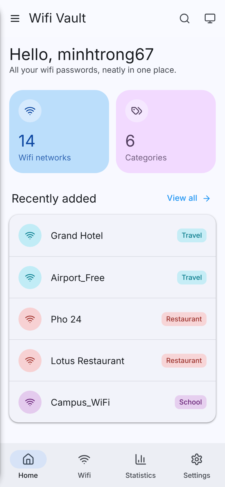
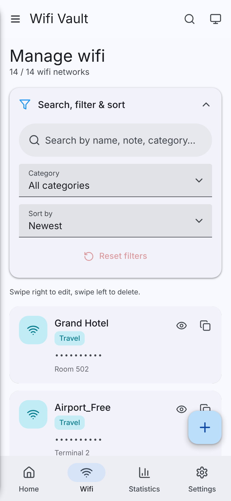
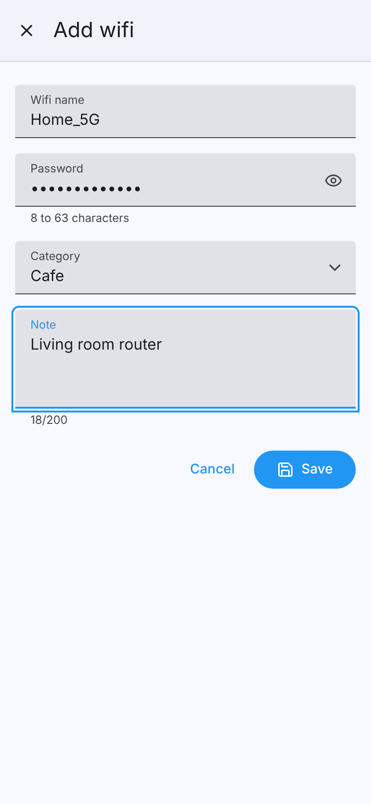
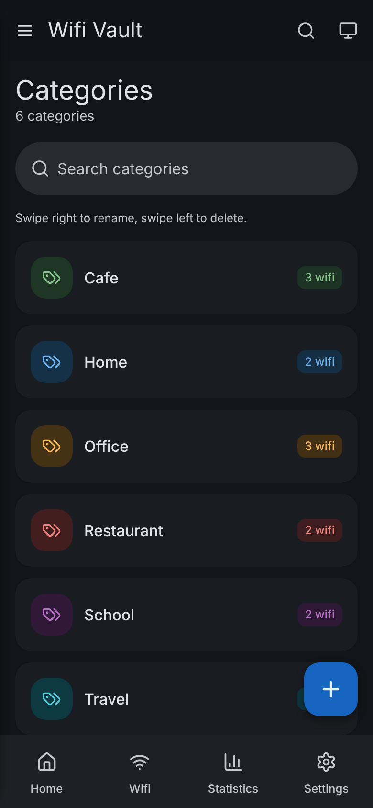
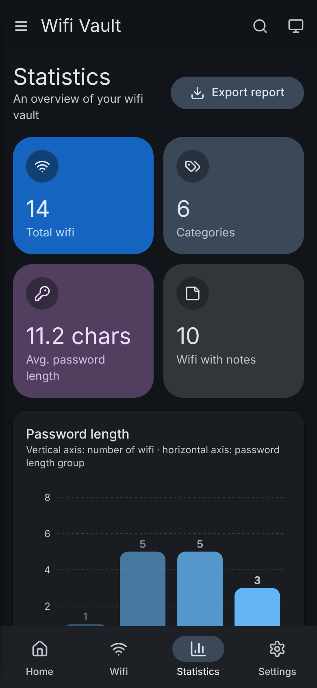
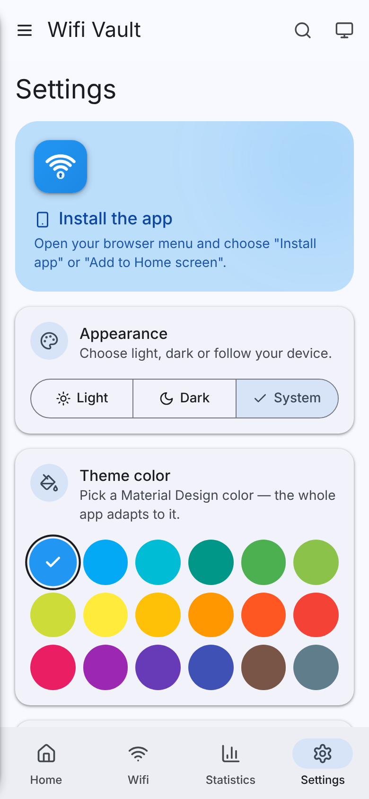

<div align="center">


# Wifi Vault

**A tidy vault to store, search and manage your wifi passwords.**
Material Design 3 · Installable PWA · English & Tiếng Việt

[](LICENSE)


English · [Tiếng Việt](README.vi.md)

Made by **minhtrong67** with the help of **Claude** (Anthropic)

</div>

---

## Table of contents

- [Introduction](#introduction)
- [Screenshots](#screenshots)
- [Features](#features)
- [Installation](#installation)
- [Tech stack](#tech-stack)
- [Development](#development)
- [Build](#build)
- [Project structure](#project-structure)
- [License](#license)

## Introduction

Wifi Vault keeps every wifi name and password you own in one place, synced to your Google account and available on all your devices. Search instantly, group networks by category, import or export your data, and install it like a native app. The interface follows **Material Design 3** and adapts to your device: light/dark mode, your language, and your favourite colour.

## Screenshots

Screenshots live in the [`screenshots/`](screenshots) folder.

| | | |
| :---: | :---: | :---: |
|  |  |  |
|  |  |  |

## Features

**Wifi management**
- Add, edit, delete, search, filter by category and sort (filters in an accordion with a **Reset filters** button)
- Add / edit in a Material **sheet drawer** (bottom sheet on mobile, side sheet on desktop)
- Swipe right to edit, swipe left to delete (with confirmation); buttons on desktop
- Quick search with `Ctrl/⌘ + K`
- Names are unique: importing a network with an existing name overwrites it instead of duplicating it

**Categories**
- Create, rename (related wifi entries are updated), delete (blocked while in use) and search

**Statistics**
- Summary cards and charts (password length, wifi per category)
- Export the report as **PDF** or **PNG**

**Settings**
- **Import / export** wifi and categories as **CSV, XLSX or JSON** (collapsible *Data* section) plus **Export all** in one go
- **Default start page**: choose which page opens when the app launches
- **Language**: automatically detects the device language (English or Tiếng Việt), or pick one manually
- **Theme colour**: choose from the Material colour palette; the full light/dark scheme is generated from your pick
- Light / dark / system mode (also a quick toggle in the header) and 3 font sizes
- **Install card**: shown only while the app is not installed
- Reset settings to defaults

**Experience**
- Material Design 3 components, state layers, ripple and Material motion
- Icon-only floating action button, scroll-to-top button, toasts, skeleton loading, reduced-motion support
- Responsive from phones to desktops, offline-friendly service worker

## Installation

### Prerequisites

- [Node.js](https://nodejs.org) 18 or newer
- A [Firebase](https://console.firebase.google.com) project

### Steps

```bash
git clone https://github.com/minhtrong67/wifi-vault.git
cd wifi-vault
npm install
cp .env.example .env
```

Configure Firebase:

1. **Authentication → Sign-in method** → enable **Google** and add your domain to *Authorized domains*.
2. **Firestore Database** → create a database, then paste [`firestore.rules`](firestore.rules) into the *Rules* tab and publish.
3. **Project settings → Your apps** → add a Web app and copy its config into `.env`:

```env
VITE_FIREBASE_API_KEY=...
VITE_FIREBASE_AUTH_DOMAIN=...
VITE_FIREBASE_PROJECT_ID=...
VITE_FIREBASE_STORAGE_BUCKET=...
VITE_FIREBASE_MESSAGING_SENDER_ID=...
VITE_FIREBASE_APP_ID=...
```

> `.env` is git-ignored. Never commit your real keys.

## Tech stack

| Area | Technology |
| --- | --- |
| UI | React 18, React Router 6 |
| Build | Vite 5 |
| Styling | Tailwind CSS 3 with Material 3 colour tokens |
| Design system | Material Design 3, `@material/material-color-utilities`, Roboto |
| Backend | Firebase Authentication (Google) + Cloud Firestore |
| Charts | Recharts |
| Files | SheetJS (`xlsx`), jsPDF, html2canvas |
| Icons | lucide-react |
| PWA | [`vite-plugin-pwa`](https://vite-pwa-org.netlify.app) (Workbox service worker, light/dark manifests) |

## Development

```bash
npm run dev       # start the dev server
npm run build     # production build into dist/
npm run preview   # serve the production build locally
```

Firestore layout:

```
users/{uid}/wifis/{id}        name, password, category, note, createdAt, updatedAt
users/{uid}/categories/{id}   name, createdAt
```

Validation: wifi name 1–32 chars, password 8–63 chars, note up to 200 chars. Import files use the columns `name, password, category, note` (Vietnamese headers are accepted too); JSON can be an array or `{ "wifis": [...] }`.

To add a language, create `src/i18n/<code>.js` with the same keys as `en.js` and register it in `src/i18n/index.js`.

## Build

```bash
npm run build
```

Deploy the `dist/` folder to Firebase Hosting, Vercel, Netlify or any static host. Add a rewrite so every path serves `index.html`, and add the deployed domain to Firebase *Authorized domains*.

## Project structure

```
wifi-vault/
├── public/            favicon and app icons (manifest + service worker are generated by vite-plugin-pwa)
├── screenshots/       README images (image01, image02, …)
├── src/
│   ├── components/    Layout, WifiCard, WifiForm, SearchPalette, ScrollTop, Credits, ui
│   ├── context/       Auth, Data, Settings, Toast
│   ├── data/          seed data
│   ├── i18n/          en.js, vi.js, language detection
│   ├── lib/           firebase, db, validate, fileIO, report, pwa
│   ├── pages/         Home, Wifi, Categories, Stats, Settings, Login
│   └── theme/         Material theme JSON + CSS variable generator
├── firestore.rules
├── tailwind.config.js
└── vite.config.js
```

## License

Wifi Vault is free and open source software released under the [MIT License](LICENSE).

---

<div align="center">

Designed and developed by **minhtrong67** · built with **Claude** by Anthropic

</div>
